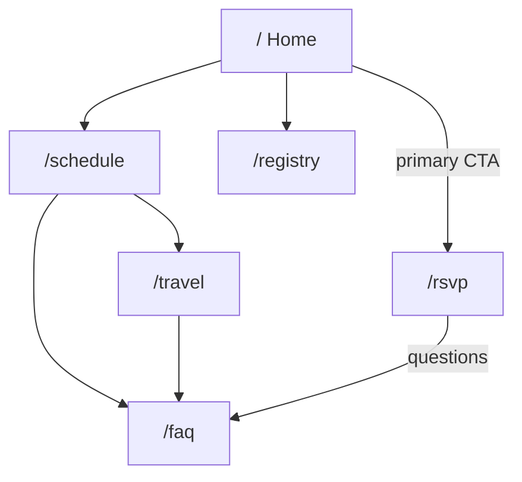

# Implementation plan

Wesley & Sela wedding site. Static Vite + React + shadcn SPA at [wesley-and-sela.joelyoung.dev](https://wesley-and-sela.joelyoung.dev). No backend. RSVP and registry are outbound links.

Vision answers live in `VISION.md`. This file is the build plan. Copy and TBD flags live in `src/content/site.ts` so a detail change is a data edit, not a layout rewrite.

## What this site is

A **logistics hub** for ~80 guests, most of them flying in. In 30 seconds on a phone someone should be able to RSVP, see what the weekend is, and get to the registry.

Tone: first person plural, funny plus formal. Vibe: woodsy, whimsical, romantic. Light and airy. Primary `#4a6b3b`, surface `#f8ebe2`. Serif titles, sans body.

Family listing, wedding party, officiant, our-story, plus-one politics, and kids policy stay **off the site**.

## What we are not building

- Any form backend. Google Form → Sheet handles RSVP, meals, plus-ones, etc.
- Guest logins, seating charts, live chat, guestbook, password gate
- Photo gallery hosting (outbound link later; photographer credit: David Lara)
- SEO work (`noindex` can come off; we are not chasing search)
- Dark mode

## Sitemap

Six routes. Shareable URLs matter because most guests are out of town and will text each other “look at travel.”

```text
/              Home — names, date, countdown-or-month, weekend snapshot, RSVP + registry CTAs
/schedule      Schedule, venue, weekend itinerary (welcome / rehearsal / brunch)
/travel        CLT, hotels, getting around, things to do
/rsvp          Short pitch + outbound Google Form
/registry      Amazon + Venmo + “boxed gifts at the venue are fine”
/faq           Dress code, unplugged, dry bar, plus-ones, weather, contact
```



Nav (planning mode): Home, Schedule, Travel, **RSVP**, Registry, FAQ.

Venue, parking, and dress-code *details* sit on Schedule + FAQ, not their own routes. A dedicated venue page is easy to split out later if the venue packet is huge.

## Site modes

One content flag, `site.mode` in `src/content/site.ts`:

| Mode | When | What changes |
| --- | --- | --- |
| `planning` | now through the week before | Full nav. Home is welcome + CTAs. |
| `day-of` | wedding weekend | Home leads with venue, time, map, “where do I go.” RSVP/registry de-emphasized. |
| `after` | post-wedding | Thank-you home. Photos link. RSVP gone. Registry optional. |

Do not fork the app. Same routes, different composition. Flip the flag and deploy.

## File structure

```text
src/
  content/site.ts              all guest-facing facts, copy, TBD
  components/
    layout/SiteShell.tsx       header + footer + outlet
    layout/SiteHeader.tsx
    layout/SiteFooter.tsx
    ComingSoon.tsx             dashed TBD block
    Countdown.tsx              hidden until date.confirmed
  pages/
    HomePage.tsx
    WeekendPage.tsx
    TravelPage.tsx
    RsvpPage.tsx
    RegistryPage.tsx
    FaqPage.tsx
    NotFoundPage.tsx
  App.tsx                      routes
public/images/                 hero + supporting photos (not in git yet)
```

## Content model

`src/content/site.ts` is the CMS. Patterns:

- Confirmed copy is a string.
- Unknown details are `{ status: 'tbd', note?: string }` and render `<ComingSoon />`.
- Outbound URLs that are not ready still exist as fields so the page does not get redesigned when the link lands.

Date: show **Early June 2027** (first weekend of June, year inferred from now). Do **not** run a ticking countdown until `date.confirmed` is true — a countdown to the wrong Saturday is worse than no countdown.

RSVP form URL is a placeholder until the Google Form exists. Swap `site.rsvp.formUrl` and `site.rsvp.placeholder` in one place.

## TBD inventory

Ship the page anyway. Each of these is a `ComingSoon` (or a placeholder link), not a missing route.

| Item | Where it shows |
| --- | --- |
| Exact date + start time | Home, Weekend, Countdown |
| Venue name / address / parking / map | Weekend |
| Weekend event list + who’s invited | Weekend |
| RSVP Google Form + deadline | RSVP |
| Hotel block, second-choice hotels, rental vs rideshare | Travel |
| Things to do in Waxhaw / Charlotte | Travel |
| Amazon registry + Venmo | Registry |
| Photo gallery link | Home footer / after-mode home |
| Dress-code “looks like” photos | FAQ (copy we have: summer semi-formal, grass, outdoor, hot) |
| Day-of arrive-by time, end time, accessibility | Weekend / FAQ |
| Hero photos | Home (typographic hero until they land in `public/images`) |

Known now, already in copy:

- Waxhaw, NC; most guests out of state; Charlotte airport
- Outdoor, early June, hot, bug spray is smart, grass shoes
- Summer semi-formal
- Unplugged ceremony
- Dry wedding
- No plus-one unless the invite says so; questions → wedding email
- Boxed gifts at the venue are fine; Amazon + Venmo coming
- Wedding email: `selaandwesleyswedding@gmail.com`
- Photographer credit later: David Lara

## Design notes

- Tokens in `src/index.css`: moss primary, cream surface, warm dark text. No dark theme.
- Headings: Cormorant (romantic serif). Body: Geist.
- Mobile-first. Sticky header. RSVP is the loudest nav item in planning mode.
- Placeholders should look intentional (cream card, moss dashed border), not like a broken page.
- Avoid comic sans. Avoid countdown-until-we-have-a-date.

## Phases

**0 — this scaffold.** Routes, layout, content module, TBD blocks, palette. Site is shareable as “details coming, here’s where they’ll live.”

**1 — make it feel like them.** Hero photo, heading rhythm, a little woodsy ornament, real FAQ wording pass with Sela/Wesley. Still placeholders for venue/hotels.

**2 — details as they lock.** Venue + map, hotel block, Google Form URL, registry links, exact date → turn countdown on. Each is a `site.ts` edit plus maybe a map embed.

**3 — day-of mode.** Flip `site.mode`, lead with address/time/parking, hide RSVP.

**4 — after mode.** Thank you, photos link, photographer credit.

Deploys are already “push to `main`.” No extra infra.

## Open calls (do not block scaffold)

1. **Wedding party** is “yes” in the section table and “not on site” in People. Treating it as **off**. Easy to add `/party` later.
2. **Hero images** are referenced in the vision doc but not in this repo yet. Drop files in `public/images/` when they arrive.
3. **RSVP placeholder** is a clearly labeled non-form until the Google Form URL exists (currently the requested rickroll URL in `site.ts`).
4. Exact Saturday in June is unknown. Copy says early June; countdown stays off.
